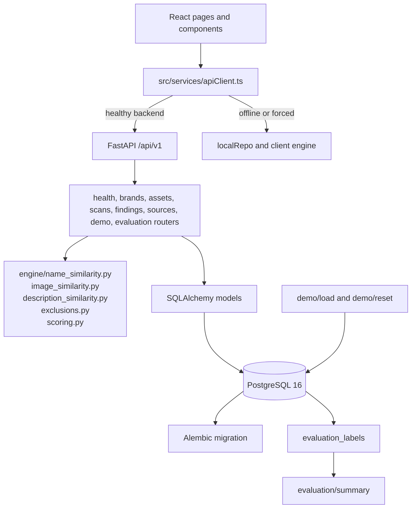
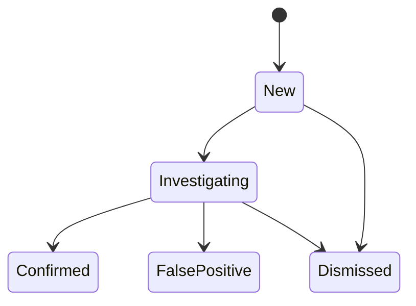

# BrandGuard - Digital Identity Protection Platform
# Live Application URL : https://brandguard-digital-identity-protect-orpin.vercel.app/

> Deterministic, explainable triage for suspicious brand social profiles and mobile applications.

BrandGuard is a React and FastAPI application for registering a brand's official identity anchors, scanning a candidate dataset, explaining why a candidate is suspicious, and moving findings through a human analyst review workflow. The repository includes a controlled synthetic benchmark for demonstrating Unicode homoglyphs, typosquatting, copied logos, identity conflicts, deceptive app packages, and strict official-asset exclusions.

The project is a local demonstration and evaluation system. Its current scan implementation evaluates database-resident candidate records; it is not a continuously running crawler and does not automatically submit takedown requests.
## Product Walkthrough

### 1. Dashboard


The dashboard provides an overview of the current detection results and investigation workflow.

### 2. Brand Registry


The brand registry stores official identity anchors used during candidate analysis and exclusion.

### 3. Findings Explorer


The findings explorer helps analysts filter and review suspicious candidate records.

### 4. Explainable Detection Evidence


Each finding includes available detection signals and explanations that help analysts understand why a candidate was flagged.

### 5. Analyst Review Workflow


Analysts can update finding statuses and record investigation notes.

## Contents

- [Problem](#problem)
- [Solution and workflow](#solution-and-workflow)
- [Feature status](#feature-status)
- [Product walkthrough](#product-walkthrough)
- [Architecture](#architecture)
- [Technology stack](#technology-stack)
- [Detection methodology](#detection-methodology)
- [Synthetic examples](#synthetic-examples)
- [Risk scoring and finding lifecycle](#risk-scoring-and-finding-lifecycle)
- [API reference](#api-reference)
- [Evaluation and testing](#evaluation-and-testing)
- [Local setup](#local-setup)
- [Data sources and integration boundaries](#data-sources-and-integration-boundaries)
- [Repository structure](#repository-structure)
- [Security and responsible use](#security-and-responsible-use)
- [Deployment instructions](#deployment-instructions)
- [Limitations and future improvements](#limitations-and-future-improvements)
- [Conclusion](#conclusion)

## Problem

Brand impersonation is not limited to an exact copy of a website. A suspicious identity may:

- use a one-character typo or a visually confusable Unicode character;
- copy a brand's logo or application icon;
- reuse official-sounding profile language;
- operate under a different social account ID, package ID, or publisher;
- appear in a mobile store with a deceptive title but a different bundle identifier.

Manual review is slow when analysts have to compare names, images, descriptions, and platform identifiers separately. It is also easy to create false positives by flagging an authorized account or a legitimate companion application. BrandGuard makes the comparison deterministic, records the evidence used, and requires corroborating signals before assigning the stronger risk bands.

The repository's `NovaPay` data is fictional synthetic data for demonstration and evaluation; it is not a real-world accusation or production feed.

## Solution and workflow

The implemented workflow is:

1. Register a protected brand with its website, description, aliases, and official identity anchors.
2. Load the isolated `NovaPay` benchmark through the demo controls or API.
3. Start a scan for the selected brand.
4. Read candidate records from the active database dataset. The current scan route records this source as `synthetic_demo`.
5. Check official social IDs and application package IDs before scoring.
6. Calculate name, logo, description, and identity-conflict signals.
7. Normalize the available signal weights and apply corroboration guardrails.
8. Persist findings, signal explanations, exclusions, and scan statistics in PostgreSQL.
9. Inspect evidence in the frontend and transition a finding through analyst review.
10. Generate a takedown notice **draft** with a human verification checklist.

The frontend also supports a client-side demonstration engine and local storage fallback when the FastAPI service is unavailable. The Settings page can force client mode or configure a different API base URL.


## Feature status

| Capability | What is implemented | Status |
|---|---|---|
| Brand registry | Create, list, retrieve, update, and archive brands; normalize official domains | Implemented |
| Aliases | Add alternate brand spellings through the API and demo data | Implemented |
| Official social anchors | Store platform, handle, and optional external account ID | Implemented |
| Official app anchors | Store platform, package/bundle ID, and publisher metadata | Implemented |
| Candidate analysis | Analyze database-resident social and mobile-app records | Implemented |
| Unicode and leetspeak detection | NFKC normalization, selected homoglyph mapping, and deterministic substitutions | Implemented |
| Logo comparison | Compare 64-bit hexadecimal perceptual hashes by Hamming distance | Implemented |
| Description comparison | Stopword-filtered term-frequency cosine comparison | Implemented |
| Risk scoring | Weighted, coverage-aware composite and corroboration rules | Implemented |
| Official exclusions | Exact social external-ID and app package-ID checks, with handle fallback only when no ID exists | Implemented |
| Analyst workflow | Finding filters, review status, notes, immutable review events | Implemented |
| Takedown report | Markdown draft and human pre-submission checklist | Implemented; no automatic submission |
| Synthetic evaluation | Isolated labels and confusion-matrix metrics | Implemented |
| Apple iTunes source catalog | Listed as an available source in `/sources` | Cataloged; not wired into the current scan execution |
| CSV/JSON ingestion | Listed as a source concept | Not implemented as an upload route |
| Scheduled monitoring | No scheduler or recurring scan implementation is present | Not implemented |
| Authentication and authorization | No user authentication or role enforcement is present | Not implemented |

## Product walkthrough

No screenshot files were present in the repository at audit time, so this README does not embed fabricated images. The real interface can be inspected at `http://localhost:3000` after starting the frontend.

Recommended genuine capture checklist:

1. **Overview** - show the risk distribution, candidate counts, and current backend/client mode.
2. **Brand Registry** - show a registered brand, aliases, and official social/app anchors.
3. **Scan setup** - show the available synthetic source before launching a scan.
4. **Findings Explorer** - show risk-band and platform filters.
5. **Evidence modal** - show raw signal values, methods, explanations, and candidate metadata.
6. **Analyst review** - show a status transition and note.
7. **Takedown draft** - show the draft label and human checklist.
8. **Benchmark Evaluation** - show the confusion matrix returned by the API or client engine.
9. **Settings** - show backend health and client fallback controls.

If screenshots are captured, save only genuine application screens under `docs/screenshots/` and embed them with relative links. Do not use the remote Unsplash URLs in the synthetic fixture as product screenshots.

## Architecture

The system is a modular monolith with two execution modes:

- **Frontend:** React 19 + TypeScript + Vite. `src/services/apiClient.ts` calls the FastAPI API when healthy and otherwise uses `src/services/storage.ts` and the client detection engine.
- **Backend:** FastAPI routers under `backend/app/routers/`, SQLAlchemy models, Pydantic schemas, and Alembic migrations.
- **Persistence:** PostgreSQL 16 in Docker Compose. The backend defaults to a PostgreSQL URL and uses SQLAlchemy sessions.
- **Detection engine:** Pure deterministic Python modules under `backend/app/engine/`.
- **Evaluation:** Ground-truth labels are stored separately in `evaluation_labels`; the scan logic does not query those labels.
- **Source catalog:** `/sources` describes the synthetic feed, a future imported dataset channel, and an Apple iTunes Search API entry. The current `/scans` implementation uses all `DatasetRecord` rows and labels the source result as the synthetic benchmark feed.



There is no separate worker, queue, crawler, scheduler, authentication service, or automatic takedown service in this repository.

## Technology stack

| Technology | Layer | Verified usage |
|---|---|---|
| React 19 | Frontend | UI pages, modals, navigation, and review workflow |
| TypeScript | Frontend | Typed domain models and API client |
| Vite 8 | Frontend tooling | Development server and production bundle |
| Tailwind CSS 4 | Frontend styling | Utility-based UI styling via the Vite plugin |
| Recharts | Frontend | Risk and evaluation visualizations |
| Lucide React and Motion | Frontend UI | Icons and interaction effects |
| FastAPI 0.111 range | Backend | REST API and OpenAPI/Swagger |
| Uvicorn | Backend runtime | ASGI development server |
| SQLAlchemy 2 | Persistence | ORM models and database sessions |
| PostgreSQL 16 | Database | Docker Compose development database |
| Alembic | Database tooling | Schema migration `0001_initial_schema.py` |
| Pydantic 2 | API contracts | Request and response schemas |
| RapidFuzz | Detection | Name similarity and token ratios |
| Pillow and ImageHash | Detection | Perceptual image-hash support and hash comparison |
| NumPy and scikit-learn dependencies | Backend environment | Declared detection dependencies; the current description module performs its own term-frequency cosine calculation |
| pytest, Hypothesis, Ruff, mypy | Backend development | Declared test and quality tooling |

## Detection methodology

### Name similarity, normalization, and homoglyphs

`backend/app/engine/name_similarity.py` applies Unicode NFKC normalization, maps a selected Cyrillic/Greek confusable set, removes non-alphanumeric characters for compact comparison, and lowercases the result. It detects:

- exact raw-name matches: `100.0`;
- mapped homoglyphs that become the reference name: `96.0`;
- mapped leetspeak substitutions such as `N0vaPay`: `92.0`;
- remaining candidates with RapidFuzz ratio and token-sort ratio.

The output retains the raw and normalized values, a method name, a homoglyph flag, and a readable explanation. The mapping is intentionally finite; it is not a complete Unicode confusables database.

### Logo and icon similarity

`compute_hash_distance` compares two hexadecimal hashes as integers, counts set bits in their XOR, and returns a score plus the Hamming distance. A distance of zero is identical; distances up to five receive a near-identical score. Missing or malformed hashes are reported as unavailable rather than silently treated as positive evidence. The scan uses the first stored brand image hash, or the demo hash fallback when no image asset has been uploaded.

### Description similarity

`compute_description_similarity` tokenizes alphabetic words of length two or more, removes a small stopword set, builds term-frequency counters, and computes cosine similarity. The response includes a percentage score, up to five shared keywords, and an explanation. Although the method is named `tfidf_cosine_similarity`, the current implementation uses term frequency rather than an inverse-document-frequency corpus.

### Identity conflicts

The scan assigns an identity-conflict signal when a social candidate has an external account ID or lacks one, and when a mobile-app candidate has a package ID or lacks one. An exact official match is removed before signals are calculated. A different external ID or package ID remains available as evidence of an identity conflict.

### Official asset exclusion

Exclusion is deliberately performed before scoring:

- For social profiles, a registered external account ID requires the same platform and exact ID. A matching handle alone is not enough when an official ID exists.
- If no official external ID is registered, normalized handle equality on the same platform is used as a fallback.
- For mobile applications, platform and exact package/bundle ID must match.
- A shared developer ID is supporting metadata only and never excludes a different package.

### Risk scoring

The configured base weights are:

| Signal | Weight |
|---|---:|
| Name similarity | 40% |
| Logo similarity | 25% |
| Identity conflict | 20% |
| Description similarity | 15% |

Only available signals participate, and their weights are normalized over the available set. A candidate with only one high name signal cannot become `medium` or `high`; it is capped at `needs_review`. Strong corroboration requires at least two available signals at or above 60. Moderate corroboration requires at least two at or above 45. The current enum labels are:

- `ignored`: composite below 30;
- `needs_review`: composite at least 30 without sufficient corroboration;
- `medium`: composite at least 55 with moderate corroboration;
- `high`: composite at least 75 with strong corroboration.

The API stores each signal's raw score, method, raw and normalized values, explanation, and contribution metadata. In the current scan persistence loop, the stored `FindingSignal.weight` field is written as `0.25` for each signal even though the composite scorer uses the base weights above; treat the persisted contribution fields as evidence metadata, not as the authoritative recomputation of the composite.

## Synthetic examples

The benchmark is a controlled fictional dataset loaded by `POST /api/v1/demo/load`. Representative records include:

| Candidate pattern | Evidence | Expected behavior |
|---|---|---|
| `NovaPay` with a different Twitter ID | Exact name, copied logo hash, rogue external ID | High-risk corroborated finding |
| `NovаPay Rewards` | Cyrillic `а` (`U+0430`), near-identical hash, rogue ID | High-risk homoglyph finding |
| `NovaPqy Official` | One-character substitution and similar description | Candidate is scored as a typo/lookalike |
| `NovaPay: Fast Mobile Wallet` | Copied icon, brand title, different package and developer | High-risk deceptive-app candidate |
| Official `novapay` Twitter account | Exact platform and registered external ID | Excluded before scoring |
| Official `com.novapay.wallet` app | Exact platform and package ID | Excluded before scoring |
| Different app from the same publisher | Same developer ID but different package ID | Not excluded merely because publisher matches |

These are synthetic records, not observations from live platforms.

## Risk scoring and finding lifecycle



Findings are created with review status `new`. `PATCH /findings/{finding_id}/review` accepts `investigating`, `confirmed`, `false_positive`, or `dismissed`, stores analyst notes and a review timestamp, and appends a `ReviewEvent` containing the previous status, new status, notes, and reviewer identity. The original signal records remain attached to the finding.

The report route generates a Markdown draft containing the target, score, risk band, technical signal breakdown, recommended escalation, and four human verification checks. It is explicitly marked `DRAFT - FOR HUMAN REVIEW ONLY`; it does not contact a platform or remove content.

## API reference

The backend exposes OpenAPI at `/api/v1/openapi.json`, Swagger UI at `/docs`, and ReDoc at `/redoc`. In local Docker Compose these are available at `http://localhost:8000`.

| Method | Path | Purpose |
|---|---|---|
| GET | `/api/v1/health/live` | Process liveness and version |
| GET | `/api/v1/health/ready` | Readiness-shaped response with environment metadata |
| GET | `/api/v1/brands` | List active brands |
| POST | `/api/v1/brands` | Create a brand with website, optional description/logo, and aliases |
| GET | `/api/v1/brands/{brand_id}` | Retrieve a brand |
| PATCH | `/api/v1/brands/{brand_id}` | Update metadata or active state |
| POST | `/api/v1/brands/{brand_id}/aliases` | Add a normalized alias |
| GET | `/api/v1/brands/{brand_id}/assets` | List official anchors |
| POST | `/api/v1/brands/{brand_id}/assets` | Register a social or mobile-app anchor |
| PATCH | `/api/v1/assets/{asset_id}` | Update official-anchor metadata |
| DELETE | `/api/v1/assets/{asset_id}` | Delete an official anchor |
| POST | `/api/v1/scans` | Run a deterministic scan for a brand |
| GET | `/api/v1/scans?brand_id={id}` | List scan summaries |
| GET | `/api/v1/findings` | Filter findings by brand, scan, platform, band, status, type, search, limit, and offset |
| GET | `/api/v1/findings/{finding_id}` | Retrieve candidate, signals, evidence, and review events |
| PATCH | `/api/v1/findings/{finding_id}/review` | Update review state and append an audit event |
| GET | `/api/v1/findings/{finding_id}/report` | Generate a human-reviewed Markdown takedown draft |
| GET | `/api/v1/sources` | List configured source catalog entries |
| GET | `/api/v1/sources/status` | Return source counts and integration status |
| POST | `/api/v1/demo/load` | Seed the NovaPay benchmark and isolated labels |
| POST | `/api/v1/demo/reset` | Reset scans/findings and reload demo data |
| GET | `/api/v1/evaluation/summary` | Compute confusion matrix and technique metrics |

There is no authentication requirement in the route definitions. Do not expose this development configuration to an untrusted network without adding authentication, authorization, and deployment hardening.

Example local commands:

```powershell
Invoke-RestMethod -Method Get http://localhost:8000/api/v1/health/live
Invoke-RestMethod -Method Post http://localhost:8000/api/v1/demo/load
Invoke-RestMethod -Method Get http://localhost:8000/api/v1/evaluation/summary
```

## Evaluation and testing

### Backend tests

The repository declares pytest and contains focused tests for:

- exact name matching;
- Cyrillic homoglyph detection;
- leetspeak substitution;
- name-only risk capping;
- corroborated high-risk classification;
- official social and app exclusions in `test_exclusions.py`.

Run:

```powershell
cd backend
& "C:\Users\meera\AppData\Local\Programs\Python\Python313\python.exe" -m pytest tests -v
```

The repository targets Python 3.12 in `pyproject.toml`; the command above used the available Python 3.13 interpreter during this audit. Dependencies must be installed first.

### Frontend checks

```powershell
npm run lint
npm run build
```

`npm run lint` runs `tsc --noEmit`; `npm run build` runs the Vite production build. From the initial checkout, dependency installation stopped at an existing peer-dependency conflict between `vite@8.3.4` and `esbuild@0.25.12`; no dependency manifest was changed.

With the declared dependencies installed using `npm install --legacy-peer-deps`, the typecheck passed. The production build also required the missing Recharts peer package `react-is` to be supplied locally (`npm install --no-save --legacy-peer-deps react-is`); adding that package to the project manifest is a follow-up dependency-maintenance task.

### Synthetic evaluation

`GET /api/v1/evaluation/summary` computes:

- **TP:** a synthetic impersonator predicted as medium or high;
- **FP:** a non-impersonator predicted as medium or high;
- **FN:** a synthetic impersonator not predicted as medium or high;
- **TN:** a non-impersonator correctly not predicted as medium or high.

Precision, recall, false-positive rate, F1, exclusion correctness, and per-technique metrics are calculated at request time. The labels are isolated in `evaluation_labels` and are not read by the scan detector. Any metric shown by the UI is therefore a controlled synthetic result, not evidence of production accuracy. The repository should be treated as the source of truth for the result after the demo dataset has been loaded and a scan has run.

## Local setup

### Prerequisites

- Node.js and npm compatible with the declared frontend dependencies.
- Python 3.12 is the configured backend target.
- Docker Desktop with Compose, or a reachable PostgreSQL 16 instance.

### Frontend only / client demonstration

```powershell
npm install --legacy-peer-deps
npm run dev
```

Open `http://localhost:3000`. If the backend is unavailable, the client uses its local repository and client-side engine. The Settings page can force this mode.

### Backend with Docker Compose

```powershell
cd backend
docker compose up --build
```

Compose starts PostgreSQL 16, runs `alembic upgrade head`, and starts Uvicorn on port 8000. The frontend's default API URL is `http://localhost:8000/api/v1`.

### Backend without Docker

```powershell
cd backend
py -3.12 -m venv venv
.\venv\Scripts\Activate.ps1
python -m pip install -r requirements.txt
```

Set `DATABASE_URL` to a PostgreSQL database, then run:

```powershell
alembic upgrade head
uvicorn app.main:app --host 0.0.0.0 --port 8000 --reload
```

The settings class reads `.env`, accepts `DATABASE_URL`, and provides development CORS defaults for ports 3000 and 127.0.0.1:3000. Do not copy the development database password from Compose into a production deployment.

### Demo sequence

1. Start PostgreSQL and the backend.
2. Start the frontend.
3. Use **Reset Benchmark Fixtures** or call `POST /api/v1/demo/reset`.
4. Launch a scan for the loaded `NovaPay` brand.
5. Inspect the findings and evidence.
6. Change a finding's review status and add a note.
7. Generate a draft report.
8. Open the evaluation view after the scan to inspect computed metrics.

## Data sources and integration boundaries

The `/sources` response currently describes:

| Source | Current behavior |
|---|---|
| Synthetic Identity Benchmark Feed | Local deterministic records; this is the source used by the current scan route |
| Enterprise CSV/JSON Snapshot Ingestion | Described as ready in the catalog, but no upload/import router is present |
| Apple iTunes Store Search API | Described as available at `https://itunes.apple.com/search`, but no provider adapter or live request is present in the current scan route |

No credentials are required for the offline benchmark. No provider credentials, quota guarantees, pricing claims, or live-search success should be inferred from the source catalog alone. A future live provider adapter would need explicit request validation, rate-limit handling, provenance, retries, and tests with permitted credentials.

## Repository structure

```text
.
├── src/
│   ├── App.tsx
│   ├── components/             # Navbar, sidebar, modals, badges, notices
│   ├── data/syntheticData.ts   # Client-side demo fixtures
│   ├── engine/                 # Client-side deterministic engine
│   ├── pages/                  # Overview, registry, monitoring, findings, evaluation, settings
│   ├── services/               # API client and local storage fallback
│   └── types/brandguard.ts     # Shared frontend domain types
├── backend/
│   ├── app/
│   │   ├── engine/             # Similarity, exclusion, and scoring modules
│   │   ├── models/             # SQLAlchemy entities
│   │   ├── schemas/            # Pydantic request/response contracts
│   │   ├── routers/            # FastAPI resource routes
│   │   ├── data/               # Synthetic benchmark definition
│   │   ├── config.py           # Environment-backed settings
│   │   └── main.py             # API assembly, CORS, request IDs, OpenAPI
│   ├── alembic/                # Database migration history
│   ├── tests/                  # Engine and exclusion tests
│   ├── docker-compose.yml
│   ├── requirements.txt
│   └── pyproject.toml
├── index.html
├── package.json
├── tsconfig.json
└── vite.config.ts
```

## Security and responsible use

Implemented safeguards include:

- deterministic, inspectable scoring rather than opaque classification;
- strict official-asset exclusion before threat scoring;
- isolated ground-truth labels for evaluation;
- request IDs and process-time headers from FastAPI middleware;
- Pydantic request validation for the documented API schemas;
- human review and a pre-submission checklist before using a takedown draft;
- no automated destructive action against external platforms.

Important controls that are not implemented:

- authentication, authorization, tenant isolation, and reviewer identity verification;
- production secret management and rotation;
- rate limiting, audit-log integrity protection, and abuse monitoring;
- robust file upload validation/storage (the current asset model stores metadata; it does not provide a complete upload pipeline);
- provider-specific permission enforcement and live-source provenance validation.

Use only data and platform access for which the operator has authorization. Treat generated findings as triage evidence requiring human verification, not as a legal conclusion.

## Deployment instructions

The repository provides a development-oriented Docker Compose deployment for PostgreSQL and FastAPI. It does not include a production frontend host, container image for the frontend, CI workflow, managed database configuration, TLS configuration, or verified public deployment URL.

For a real deployment, at minimum:

1. Build the frontend with `npm run build` and serve the generated `dist/` directory from a configured static host.
2. Run the backend under a production ASGI process with a managed PostgreSQL database.
3. Run `alembic upgrade head` as a controlled migration step.
4. Set a restricted `CORS_ORIGINS` value and a non-development `DATABASE_URL`.
5. Store credentials in the hosting provider's secret manager.
6. Add authentication and authorization before exposing brand and finding data.
7. Verify `/api/v1/health/live` and database readiness behavior behind the deployment's health checks.
8. Configure persistent database backups and retention.

No deployment is claimed by this repository.

## Limitations and future improvements

Current limitations are material:

- The scan route evaluates database records rather than performing broad social-platform discovery.
- The Apple iTunes entry is a catalog record, not a verified live scan adapter.
- The CSV/JSON entry has no implemented import endpoint.
- Synthetic data is small, fictional, and controlled; its metrics do not estimate real-world precision or recall.
- Candidate quality depends on available names, descriptions, hashes, external IDs, and package IDs.
- The homoglyph table is finite and does not replace a complete Unicode security policy.
- Description comparison is simple term-frequency cosine similarity despite the method label mentioning TF-IDF.
- There is no authentication, authorization, multi-tenancy, rate limiting, or production audit hardening.
- There is no scheduler or recurring monitoring service.
- Findings are not documented as deduplicated across scans; the scan loop can create another finding for the same dataset record on another run.
- The client fallback and backend do not guarantee identical persistence behavior.

Reasonable next steps are a tested provider-adapter interface, authorized live app/social ingestion, durable finding deduplication, stronger asset upload handling, authentication and tenant isolation, background job orchestration, richer Unicode policy data, and a larger independently labeled evaluation set.

## Conclusion

BrandGuard demonstrates an evidence-based workflow for identifying suspicious digital identities without making the detector itself opaque. Its main technical contribution is the combination of deterministic name, visual, description, and identity-anchor signals with strict official-asset exclusions and a name-only corroboration guardrail. The application persists the evidence, supports analyst review and audit events, and produces a human-reviewed takedown draft. The current implementation is intentionally bounded: its repeatable scan is based on a local synthetic benchmark, while live discovery, authentication, scheduled monitoring, and automatic enforcement remain outside the verified feature set.
